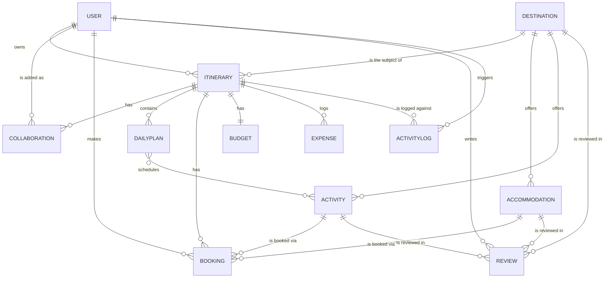

# Planning Document — Travel Itinerary Planning & Booking API

## Entity Relationship Diagram

The system contains 12 models across 7 apps: `User`, `Destination`, `Itinerary`, `Collaboration`, `DailyPlan`, `Accommodation`, `Activity`, `Booking`, `Review`, `Budget`, `Expense`, and `ActivityLog`.

## API Endpoint List

| Method            | Endpoint                                                                                          | Type              |
| ----------------- | ------------------------------------------------------------------------------------------------- | ----------------- |
| POST              | `/api/v1/accounts/register/`                                                                      | FBV               |
| POST              | `/api/v1/accounts/login/`                                                                         | FBV               |
| POST              | `/api/v1/accounts/token/refresh/`                                                                 | SimpleJWT         |
| GET/PUT           | `/api/v1/accounts/profile/`                                                                       | CBV               |
| GET/POST          | `/api/v1/itineraries/search/`                                                                     | FBV               |
| GET               | `/api/v1/itineraries/<id>/report/`                                                                | FBV               |
| POST              | `/api/v1/bookings/bulk-update/`                                                                   | FBV               |
| GET/POST          | `/api/v1/itineraries/create/`                                                                     | CBV               |
| GET/PUT/DELETE    | `/api/v1/bookings/<id>/manage/`                                                                   | CBV               |
| POST/PATCH/DELETE | `/api/v1/itineraries/<id>/collaborators/...`                                                      | CBV               |
| CRUD              | `/api/v1/{itineraries,destinations,accommodations,activities,bookings,reviews,budgets,expenses}/` | ViewSets          |
| GET               | `/api/v1/analytics/` and summary endpoints                                                        | ViewSet           |
| GET               | `/api/v1/activity-logs/`                                                                          | Read-only ViewSet |

## Authentication Flow

1. Register or log in to receive access and refresh JWTs.
2. Send `Authorization: Bearer <access>` with authenticated requests.
3. Access tokens expire after 1 hour; the refresh token is valid for 7 days.
4. Use `/accounts/token/refresh/` to obtain a new access token.
5. Logout blacklists the refresh token when the blacklist app is enabled.

## Permission Matrix

| Role           | View | Edit | Delete | Collaborators | Book/Review |
| -------------- | ---- | ---- | ------ | ------------- | ----------- |
| Owner          | ✅    | ✅    | ✅      | ✅             | ✅           |
| Editor         | ✅    | ✅    | ❌      | Admin only    | Own         |
| Viewer         | ✅    | ❌    | ❌      | ❌             | Own         |
| Unrelated user | ❌    | ❌    | ❌      | ❌             | n/a         |
| Anonymous      | ❌    | ❌    | ❌      | ❌             | n/a         |

Permissions use `IsTripOwner`, `IsTripOwnerOrCollaborator`, `CanEditItinerary`, `IsBookingOwner`, `IsReviewOwnerOrReadOnly`, and `IsItineraryOwnerOrCollaborator`.

## URL Structure

All routes use `/api/v1/`. ViewSets share a root `DefaultRouter`, while each app has a namespaced `urls.py` for FBV/CBV routes. App routes use `/api/v1/<app>/`, preventing route conflicts.

## Testing Strategy

* **Models:** Test validation, computed properties, and business logic such as collaboration, booking, review, and budget methods.
* **Serializers:** Test validation and nested representations through API requests.
